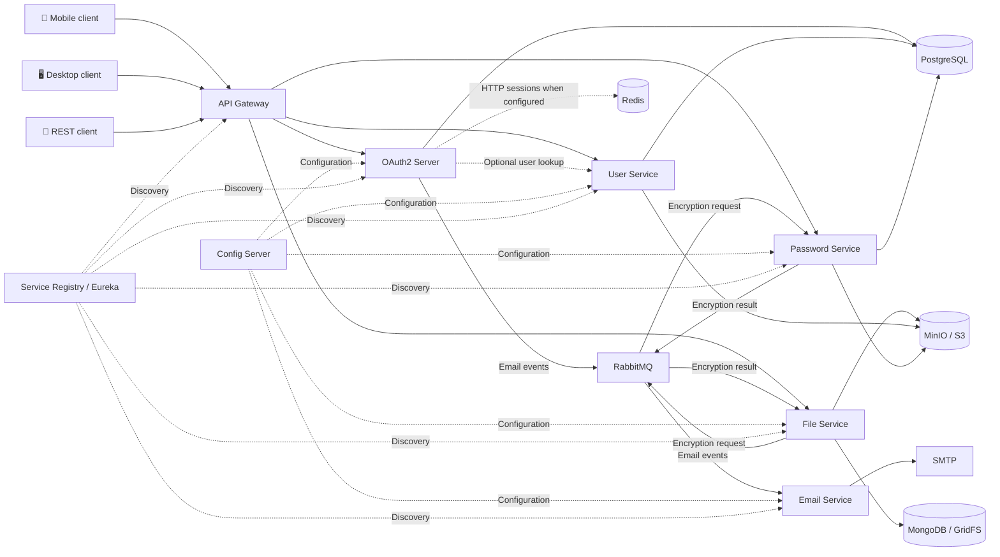

# MHPasswordManager

App project to store and encrypt all passwords with key pair and full validation

# SonarQube

[](https://app-qsonar.marcosilva.dev/dashboard?id=marcoshssilva-password-manager)

[](https://app-qsonar.marcosilva.dev/dashboard?id=marcoshssilva-password-manager)
[](https://app-qsonar.marcosilva.dev/dashboard?id=marcoshssilva-password-manager)
[](https://app-qsonar.marcosilva.dev/dashboard?id=marcoshssilva-password-manager)
[](https://app-qsonar.marcosilva.dev/dashboard?id=marcoshssilva-password-manager)
[](https://app-qsonar.marcosilva.dev/dashboard?id=marcoshssilva-password-manager)

## Repositories Project
- (source) [marcoshssilva/MHPasswordManager](https://github.com/marcoshssilva/MHPasswordManager)
- (source) [marcoshssilva/MHPasswordManager-Frontend](https://github.com/marcoshssilva/MHPasswordManager-Frontend)
- (config-localhost) [marcoshssilva/MHPasswordManager-Config-Localhost](https://github.com/marcoshssilva/MHPasswordManager-Config-Localhost)
- (config-development) [marcoshssilva/MHPasswordmanager-Config-Development](https://g.starlord443.dev/git/marcoshssilva-dev/MHPasswordManager-Config-Development.git)

---
## Technologies

| Category | Technologies |
|---|---|
| Language and build | Java 17 (Temurin), Maven |
| Application framework | Spring Boot 2.7.18, Spring Framework 5.3.39 |
| Microservices | Spring Cloud 2021.0.9, Spring Cloud Gateway, Config Server, Netflix Eureka |
| Authentication | Spring Security, OAuth2, OpenID Connect, JWT |
| Data and storage | PostgreSQL, MongoDB / GridFS, Redis, MinIO / S3-compatible storage |
| Messaging and email | RabbitMQ, SMTP |
| Templates | Thymeleaf |
| Observability | Spring Boot Actuator, OpenTelemetry |
| Deployment | Docker Compose, Dokku |

Infrastructure and integrations may vary by profile and deployment.

---

## Architecture

MHPasswordManager consists of Spring Boot services. The API Gateway acts as a
reverse proxy and access-control layer for the main APIs, applying OAuth2 JWT
authentication, routing, connection and response timeouts, and
discovery-based load balancing. Eureka maintains the service registry, and the
Config Server centralizes service configuration.



| Service | Responsibility | Gateway path |
|---|---|---|
| API Gateway | Reverse proxy for the APIs, with access rules, JWT authentication, timeouts, and load-balanced routing. | `/` |
| OAuth2 Server | Authentication and authorization with OAuth2 and OpenID Connect, including JWT issuance and signing keys. | `/mypass-manager/auth/**` |
| User Service | REST API for accounts, roles, profile data, password recovery, and avatars. | `/mypass-manager/users/**` |
| Password Service | REST API for buckets, encrypted passwords and secrets, and cryptographic operations. | `/mypass-manager/passwords/**` |
| File Service | Manages vault files, using MongoDB, S3-compatible storage, and asynchronous encryption through the Password Service. | `/mypass-manager/files/**` |
| Email Service | Consumes RabbitMQ events and sends plain-text, HTML, or templated emails. | `/mypass-manager/emails/**`* |
| Config Server | Central API for application configuration, with optional encryption of credentials and properties. | `/config/**`* |
| Service Registry | Eureka registry for service instances, their availability, and discovery by clients. | `/eureka/**`* |

\* The Email Service route is configured in the Gateway; email delivery is
triggered through RabbitMQ. Gateway routes for Config Server and Eureka depend
on the configured allowed hosts.

The Gateway allows public routes such as login and requires authentication for
other routes, with scope-based rules for Eureka and Config Server. Requests
that do not match a configured route are redirected to the authorization
server. Circuit-breaker open/closed behavior and service-failure fallbacks are
not currently configured.

Spring Boot services use Eureka clients to register their instances and discover
other services. Eureka tracks instance availability through registrations and
heartbeats; clients can use the discovered instances with load-balanced routing
when needed. Actuator health endpoints are available separately. A circuit
breaker is not currently configured for these calls.

The Config Server centralizes application configuration and provides an
optional asymmetric encryption module for credentials and other properties.
It can decrypt encrypted properties for configured clients using its own key,
which is separate from vault keys.

The OAuth2 Server authenticates users and authorizes clients using OAuth2 and
OpenID Connect. It issues JWTs with authorized scopes and exposes signing keys
for token validation. It can integrate with the User Service for user
operations, or run independently using configured in-memory or embedded
alternatives without an external database or the User Service. Other
infrastructure dependencies depend on its configuration. When Redis-backed
Spring Session is enabled, HTTP session data is stored in Redis and the
browser holds a session identifier cookie. This session is separate from the
OAuth2 access token.

The User Service manages accounts, roles, and profile information such as
email, first name, last name, and avatar. It stores account data in a SQL
database and avatar images in S3-compatible storage, keeping their public URL
with the account details. Its API also supports account verification and
password recovery; operations are protected by scopes and roles.

The Password Service provides a REST API for managing buckets and encrypted
passwords and secrets. It uses the OAuth2 Server for authentication and
authorization and stores its data in a SQL database, preferably PostgreSQL.

The File Service complements the OAuth2-based application by managing files
associated with vaults. It stores file metadata and processing status in
MongoDB, uses S3-compatible object storage, and coordinates encryption with the
Password Service through RabbitMQ:

1. The File Service accepts an upload, records its metadata and status, and
   stages the original file in S3 before publishing an encryption request.
2. The Password Service retrieves the staged file, encrypts it with the
   bucket's public key, stores the encrypted result in S3, and publishes a
   completion or failure event.
3. On completion, the File Service stores the encrypted file in its final S3
   location and in MongoDB GridFS, marks it ready, and attempts to remove the
   staging objects. On failure, it records the error and failed status.

Uploads are asynchronous. File retrieval uses S3 first and falls back to the
GridFS copy if the S3 read fails. The staged original is not yet encrypted.

The Email Service handles email delivery through its own flow. It consumes
RabbitMQ messages containing plain-text or HTML content, or a template and
its parameters, and sends the resulting email using the configured delivery
mode.

**Main flows:**

- **Authentication:** Client → Gateway → OAuth2 Server → User Service when
  configured for API-based user lookup. The authorization server issues
  tokens for access to services.
- **Vaults and passwords:** Client → Gateway → Password Service → PostgreSQL.
  The service manages vaults and their keys and performs cryptographic operations.
- **File uploads:** Client → Gateway → File Service → S3/MinIO and RabbitMQ →
  Password Service → RabbitMQ → File Service → S3/MinIO and MongoDB GridFS.
  Processing is asynchronous.
- **Email:** OAuth2 Server → RabbitMQ → Email Service → SMTP, depending on
  the configured delivery mode.
- **Configuration:** Configured clients retrieve properties from the Config
  Server, which can decrypt encrypted properties using its configured key.
  This key is separate from vault keys.

The integrations in use may vary by profile and deployment environment.

---

## Docker Compose

You can start application following steps:

1. Clone project
    ```
    git clone https://github.com/marcoshssilva/MHPasswordManager.git
    cd MHPasswordManager
    ```
2. Build application
    ```
    JAVA_HOME="/usr/lib/jvm/java-17-openjdk-amd64"
    ./mvnw clean install -DskipTests
    ```
3. Set a keystore password (at least six characters) for this local Compose
   deployment. For example, in PowerShell:
    ```powershell
    $password = Read-Host "Config Server keystore password" -AsSecureString
    $env:CONFIG_CONFIGSERVER_CRYPTO_PASSWORD = [System.Net.NetworkCredential]::new("", $password).Password
    ```
4. Run docker compose file inside project
    ```powershell
    docker compose -f ".\docker-compose.yml" --profile all up -d --build
    ```
5. Open in browser **[127.0.0.1:8080/mypass-manager/auth](http://127.0.0.1:8080/mypass-manager/auth)**

Compose initializes a dedicated Config Server keystore once in the
`config-crypto` volume and continues to use the existing `native` Spring profile.
Keep the volume and password across restarts; losing either prevents decryption
of previously encrypted values. Do not use `docker compose down -v` unless you
intend to delete the keystore and other persistent data. See the
[Config Server README](mhpasswordmanager-config-services/README.md) for
security requirements and how to encrypt configuration values.

## Dokku

The Dokku `Procfile` starts the Config Server with the other applications. Before
deploying, configure a persistent mount for its generated PKCS#12 keystore and
provide a keystore password through Dokku's config store:

```sh
dokku storage:mount <app-name> /var/lib/dokku/data/storage/<app-name>/config-crypto:/app/config-crypto
dokku config:set <app-name> CONFIG_CONFIGSERVER_CRYPTO_PASSWORD='<strong-password>'
```

Create the host directory first if it does not exist, and ensure the Dokku app
can write to the mounted directory. On startup, the Dokku shell script generates
an RSA keystore there only when `keystore.p12` is absent, then passes its path
and password only to the Config Server process. The existing
`dokku,configserver` Spring profiles are unchanged. Keep both the mounted
keystore and its password across deployments; if either is lost or changed,
existing ciphertext may no longer be decryptable. This Dokku bootstrap does not
change the PEM/Kubernetes setup.

---

# TODO

- [ ] Create images, background, logo, policies and terms of usage
- [ ] Implements hystrix or resilience4j to improve better api calls
- [ ] Create units tests and E2E (Mockito for unit tests and MockMvc, TestContainers to E2E). If possible performance tests like stress or response time
- [ ] Upgrade Spring version and spring cloud (project is legacy using SB 2.7)
- [ ] Implements token exchange flow (preference to work with Firebase and develops mobile app)