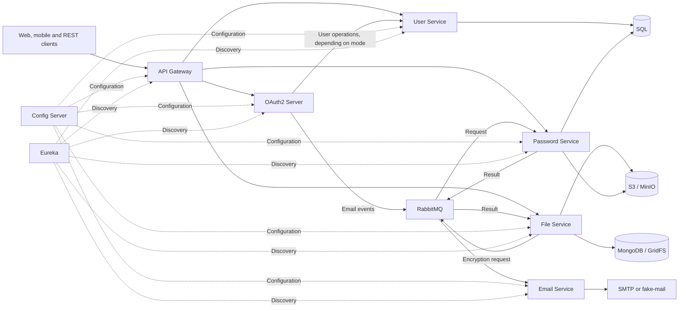
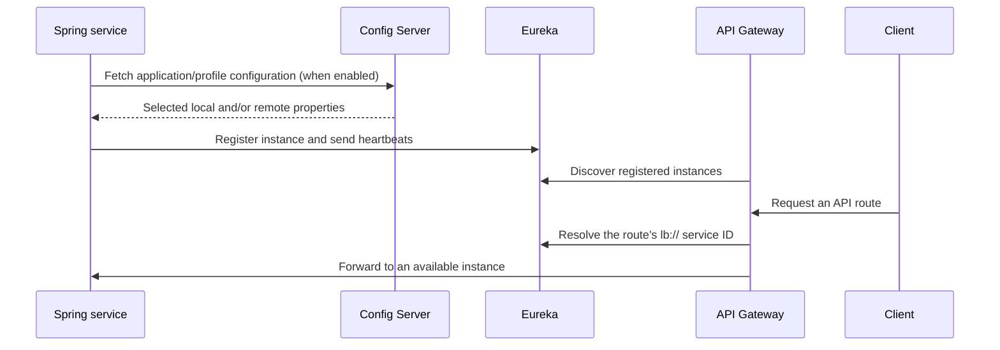

# Architecture and bootstrap

## Service topology

The Gateway receives HTTP requests, applies its authentication rules and
routes requests to services. When Eureka and Spring Cloud LoadBalancer are
configured, service routes use registered instances. RabbitMQ carries
asynchronous events; it does not replace synchronous HTTP API responses.

## Configuration and service discovery

The Config Server supplies properties; it does not start service
dependencies. Client configuration is selected by application name, active
profiles and, where applicable, a Git label. Config Server decryption of
properties depends on its encryption settings and keystore. That keystore is
separate from the keys used by Password Service vaults.

## Shared service boundaries

- Protected API requests carry `Authorization: Bearer <JWT>`. Each service
  enforces its own scopes and roles; access to the Gateway alone does not
  authorize an operation.
- User Service stores account/profile data in SQL and may store avatars in S3.
  The Gateway has a dedicated route for serving avatar images.
- File Service stores file metadata and processing state in MongoDB, with
  file objects in S3 and a GridFS copy. Password Service performs file
  encryption; RabbitMQ separates the processing stages.
- Email Service consumes events and sends messages; a producer does not
  deliver email directly.
- Eureka resolves registered services and can balance `lb://` calls.
  Config Server, Eureka, Redis, SQL, MongoDB, S3 and RabbitMQ must be
  reachable as required by each service's configuration.

## Related implementation

| Area | Source |
|---|---|
| Gateway routes | [application.yml](../mhpasswordmanager-api-gateway/src/main/resources/application.yml) |
| Gateway access rules | [WebFluxSecurityConfig](../mhpasswordmanager-api-gateway/src/main/java/br/com/marcoshssilva/mhpasswordmanager/apigateway/config/WebFluxSecurityConfig.java) |
| Config Server settings | [application.yml](../mhpasswordmanager-config-services/src/main/resources/application.yml) |
| Example OAuth2 client configuration | [authorization-server.yml](../mhpasswordmanager-config-services/src/main/resources/authorization-server.yml) |
| Local OAuth2 profile | [application-local.yml](../mhpasswordmanager-oauth2-server/src/main/resources/application-local.yml) |

