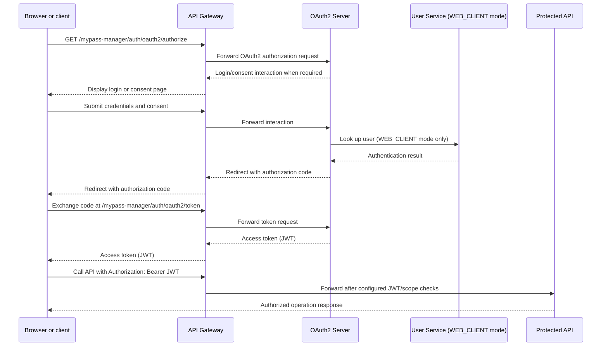
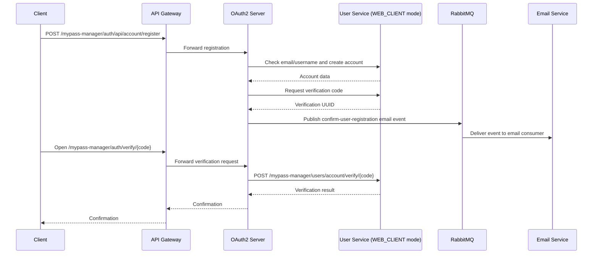

# Authentication and account lifecycle

## OAuth2 Authorization Code and API access

The OAuth2 Server handles the browser login and authorization flow. When
Spring Session Redis is enabled (as in the `local` profile), the browser
session is stored in Redis and identified by the `JSESSIONID` cookie. That
session maintains login/authorization state; it is distinct from the access
token JWT sent on subsequent API calls. The Gateway and downstream APIs
validate tokens according to their issuer/JWK configuration and apply their
own scope and role checks.

In `WEB_CLIENT` mode, OAuth2 Server calls User Service with the
`client_credentials` grant. The service token and its scopes are configured
separately from user access tokens. In `DATABASE` and `MEMORY` modes, the
OAuth2 Server uses its configured user-operation implementation instead of
the User Service REST client.

## Registration and email verification

OAuth2 Server delegates user operations to the backend selected by
`config.users.mode`. The diagram illustrates `WEB_CLIENT`; `DATABASE` and
`MEMORY` use their own user-operation implementations. Email delivery is
asynchronous; see [Messaging and email](messaging-and-email.md).

## Password recovery

The client sends `POST /mypass-manager/auth/api/account/forgot/step1`.
OAuth2 Server locates the account using the supplied identifier, generates a
recovery code, stores the request with the client's IP address and User-Agent,
and publishes a `confirm-recovery-code` email event.

The client then sends a `POST` request with the code and new password to
`/mypass-manager/auth/api/account/forgot/step2`. The server validates the code
together with the recorded IP and User-Agent, then asks the configured user
backend to update the password.

## Related implementation

| Area | Source |
|---|---|
| Authorization server security and OAuth endpoints | [AuthorizationServerSecurityConfig](../mhpasswordmanager-oauth2-server/src/main/java/br/com/marcoshssilva/mhpasswordmanager/oauth2server/configuration/AuthorizationServerSecurityConfig.java) |
| Login and verification pages | [HomeAndLoginControllerView](../mhpasswordmanager-oauth2-server/src/main/java/br/com/marcoshssilva/mhpasswordmanager/oauth2server/web/views/HomeAndLoginControllerView.java) |
| Registration and recovery endpoints | [AccountRegisterController](../mhpasswordmanager-oauth2-server/src/main/java/br/com/marcoshssilva/mhpasswordmanager/oauth2server/web/resources/AccountRegisterController.java) |
| Registration/recovery service flow | [UserServiceImpl](../mhpasswordmanager-oauth2-server/src/main/java/br/com/marcoshssilva/mhpasswordmanager/oauth2server/domain/service/impl/UserServiceImpl.java) |
| User Service REST client | [UserServiceWebClient](../mhpasswordmanager-oauth2-server/src/main/java/br/com/marcoshssilva/mhpasswordmanager/oauth2server/domain/service/clients/web/UserServiceWebClient.java) |
| Redis session profile | [application-local.yml](../mhpasswordmanager-oauth2-server/src/main/resources/application-local.yml) |

