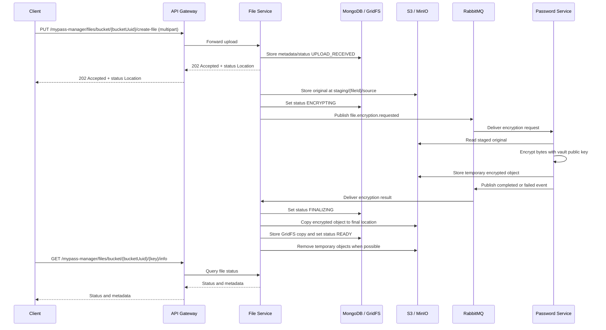

# Asynchronous file encryption

## Upload, encryption and retrieval

The upload returns `202 Accepted`: this confirms receipt for processing, not
that encryption has completed. The client can poll
`GET /mypass-manager/files/bucket/{bucketUuid}/{key}/info`; the file can be
downloaded only after `ready=true`.

The processing states include `UPLOAD_RECEIVED`, `ENCRYPTING`, `FINALIZING`,
`READY` and `FAILED`. On success, File Service stores the final object in S3
and a copy in GridFS. Reads try S3 first and fall back to GridFS. Updating an
existing file uses the same asynchronous processing flow.

Events use the `files.events` exchange and the routing keys
`file.encryption.requested`, `file.encryption.completed` and
`file.encryption.failed`. Password Service reads the staged original and
encrypts it with the vault's public key. File Service marks the record ready
only after completing the final object and GridFS writes.

## Related implementation

| Area | Source |
|---|---|
| Upload, file metadata and reads | [MongoGridFSStorageFileServiceImpl](../mhpasswordmanager-file-service/src/main/java/br/com/marcoshssilva/mhpasswordmanager/fileservice/internal/impl/MongoGridFSStorageFileServiceImpl.java) |
| Staging, events and finalization | [FileProcessingWorkerQueue](../mhpasswordmanager-file-service/src/main/java/br/com/marcoshssilva/mhpasswordmanager/fileservice/amqp/queues/FileProcessingWorkerQueue.java) |
| Encryption worker | [FileEncryptionWorkerQueue](../mhpasswordmanager-password-service/src/main/java/br/com/marcoshssilva/mhpasswordmanager/passwordservice/amqp/queues/FileEncryptionWorkerQueue.java) |
| HTTP endpoints | [BucketFileOperationsController](../mhpasswordmanager-file-service/src/main/java/br/com/marcoshssilva/mhpasswordmanager/fileservice/http/rest/BucketFileOperationsController.java) |
| Exchange, queues and bindings | [File Service RabbitConfig](../mhpasswordmanager-file-service/src/main/java/br/com/marcoshssilva/mhpasswordmanager/fileservice/configs/RabbitConfig.java), [Password Service RabbitConfig](../mhpasswordmanager-password-service/src/main/java/br/com/marcoshssilva/mhpasswordmanager/passwordservice/configs/RabbitConfig.java) |

