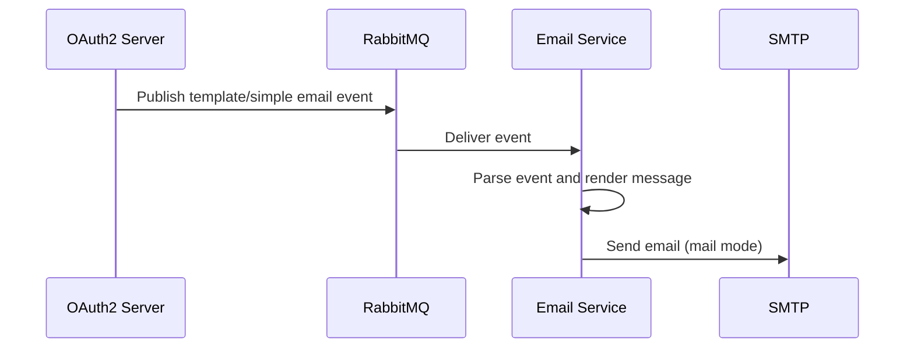

# Messaging and email

## Account-related email

OAuth2 Server publishes email events for account verification and password
recovery. The events contain template names and parameters, such as the
verification link or recovery code. Email Service consumes events from the
queue configured by `config.mail.queues-key.send-event` (default
`email.send-event`), renders the message and sends it using the configured
delivery mode.

The consumer accepts simple email events and template-based events. In
`mail` mode, it sends through SMTP; in `fake-mail` mode, it logs instead of
delivering. Processing errors are rejected without requeue by the current
listener implementation.

## File encryption events

File processing uses the `files.events` exchange with these routing keys:

| Routing key | Producer | Consumer | Purpose |
|---|---|---|---|
| `file.encryption.requested` | File Service | Password Service | Encrypt a staged file using the vault's public key. |
| `file.encryption.completed` | Password Service | File Service | Report the temporary S3 object containing the encrypted file. |
| `file.encryption.failed` | Password Service | File Service | Report an encryption failure and its error. |

The full upload and encryption lifecycle is documented in
[Asynchronous file encryption](file-encryption.md).

## Related implementation

| Area | Source |
|---|---|
| Account email event producer | [SendEmailServiceImpl](../mhpasswordmanager-oauth2-server/src/main/java/br/com/marcoshssilva/mhpasswordmanager/oauth2server/domain/service/impl/SendEmailServiceImpl.java) |
| Email event consumer | [QueueListenerEventMailMessage](../mhpasswordmanager-email-service/src/main/java/br/com/marcoshssilva/mhpasswordmanager/emailservice/amqp/listeners/QueueListenerEventMailMessage.java) |
| SMTP delivery implementation | [SMTPMailMessageServiceImpl](../mhpasswordmanager-email-service/src/main/java/br/com/marcoshssilva/mhpasswordmanager/emailservice/domain/services/mail/SMTPMailMessageServiceImpl.java) |
| File encryption event producer/consumer | [FileProcessingWorkerQueue](../mhpasswordmanager-file-service/src/main/java/br/com/marcoshssilva/mhpasswordmanager/fileservice/amqp/queues/FileProcessingWorkerQueue.java), [FileEncryptionWorkerQueue](../mhpasswordmanager-password-service/src/main/java/br/com/marcoshssilva/mhpasswordmanager/passwordservice/amqp/queues/FileEncryptionWorkerQueue.java) |
