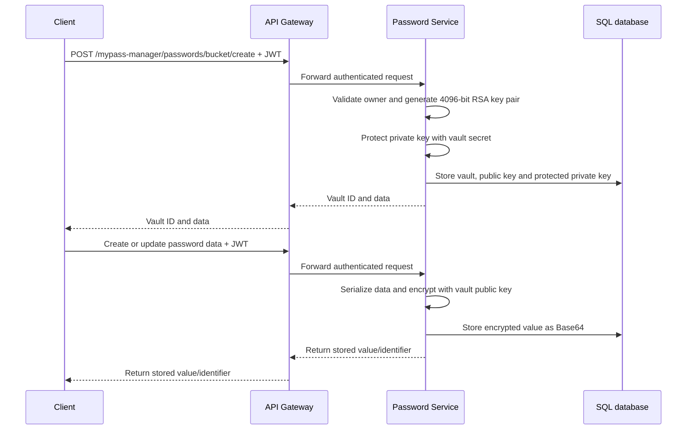

# Password vaults

## Vault creation and encrypted password records



Password Service checks vault ownership before performing operations. On
creation, it generates an RSA key pair; the private key is protected using
the vault secret, and the public key encrypts password records. Encrypted
records and vault information are stored in the SQL database.

## Export an encrypted private key

Call `GET /mypass-manager/passwords/bucket/{bucketUuid}/export-private-key` with a bearer
JWT. The request takes the vault UUID in the path. The response is available
only to the vault owner. An unknown vault or one owned by another user returns
HTTP 404.

A successful response has content type `application/json` and
`Cache-Control: no-store`. The JSON has three fields:

```json
{
  "bucketUuid": "746e40c9-f530-4d4c-be13-4c06c25d17a0",
  "base64EncodedPrivateKey": "<stored encrypted private key in standard Base64>",
  "algoritm": "AES-256-GCM"
}
```

The client decrypts the export locally using the original vault secret:

1. Decode `base64EncodedPrivateKey` using standard Base64.
2. Hash the UTF-8 bytes of the vault secret with SHA-256 and use the raw 32-byte
   digest as the AES key.
3. Split the decoded payload into the first 12 bytes (IV), the middle bytes
   (ciphertext), and the last 16 bytes (GCM authentication tag). Decrypt and
   authenticate with AES-256-GCM, an empty AAD, and a 128-bit tag.
4. Parse the authenticated plaintext as a DER-encoded PKCS#8 RSA private key.

Older vaults may have stored only ciphertext and tag with an implicit
all-zero 12-byte IV. The database stores no format version. If authentication
fails with the current format, a client supporting legacy exports may retry
using the full decoded payload as ciphertext and tag and the all-zero IV.
That format used the server JVM's default charset for the vault secret, so
use that charset if it differed from UTF-8. Accept plaintext only after the
authentication tag verifies.

The export contains the stored ciphertext. Anyone with the file can test
guesses of the vault secret offline. The existing SHA-256 derivation has no
salt or work factor, so the file's protection depends on the entropy of the
original secret.

## Related implementation

| Area | Source |
|---|---|
| Vault creation and key-pair generation | [UserBucketServiceImpl](../mhpasswordmanager-password-service/src/main/java/br/com/marcoshssilva/mhpasswordmanager/passwordservice/domain/services/data/buckets/impl/UserBucketServiceImpl.java) |
| Stored password encryption and persistence | [UserStoredKeysServiceImpl](../mhpasswordmanager-password-service/src/main/java/br/com/marcoshssilva/mhpasswordmanager/passwordservice/domain/services/data/keys/impl/UserStoredKeysServiceImpl.java) |
| RSA implementation | [RSACryptServiceImpl](../mhpasswordmanager-password-service/src/main/java/br/com/marcoshssilva/mhpasswordmanager/passwordservice/domain/services/crypt/impl/RSACryptServiceImpl.java) |
| HTTP endpoints | [BucketController](../mhpasswordmanager-password-service/src/main/java/br/com/marcoshssilva/mhpasswordmanager/passwordservice/web/controllers/BucketController.java), [ManageKeysController](../mhpasswordmanager-password-service/src/main/java/br/com/marcoshssilva/mhpasswordmanager/passwordservice/web/controllers/ManageKeysController.java) |

