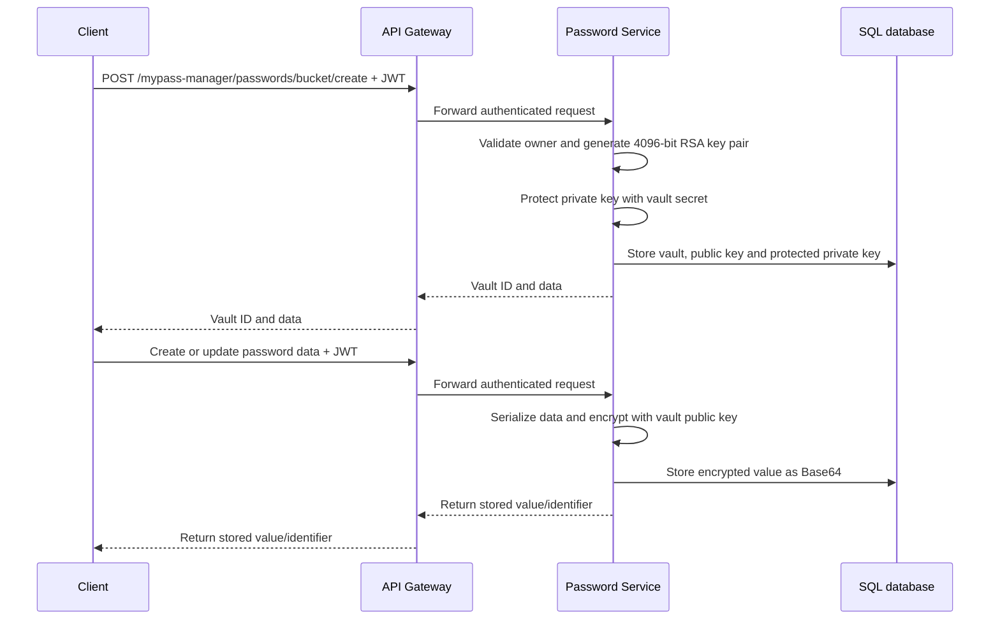

# Password vaults

## Vault creation and encrypted password records

Password Service checks vault ownership before performing operations. On
creation, it generates an RSA key pair; the private key is protected using
the vault secret, and the public key encrypts password records. Encrypted
records and vault information are stored in the SQL database.

## Related implementation

| Area | Source |
|---|---|
| Vault creation and key-pair generation | [UserBucketServiceImpl](../mhpasswordmanager-password-service/src/main/java/br/com/marcoshssilva/mhpasswordmanager/passwordservice/domain/services/data/buckets/impl/UserBucketServiceImpl.java) |
| Stored password encryption and persistence | [UserStoredKeysServiceImpl](../mhpasswordmanager-password-service/src/main/java/br/com/marcoshssilva/mhpasswordmanager/passwordservice/domain/services/data/keys/impl/UserStoredKeysServiceImpl.java) |
| RSA implementation | [RSACryptServiceImpl](../mhpasswordmanager-password-service/src/main/java/br/com/marcoshssilva/mhpasswordmanager/passwordservice/domain/services/crypt/impl/RSACryptServiceImpl.java) |
| HTTP endpoints | [BucketController](../mhpasswordmanager-password-service/src/main/java/br/com/marcoshssilva/mhpasswordmanager/passwordservice/web/controllers/BucketController.java), [ManageKeysController](../mhpasswordmanager-password-service/src/main/java/br/com/marcoshssilva/mhpasswordmanager/passwordservice/web/controllers/ManageKeysController.java) |

